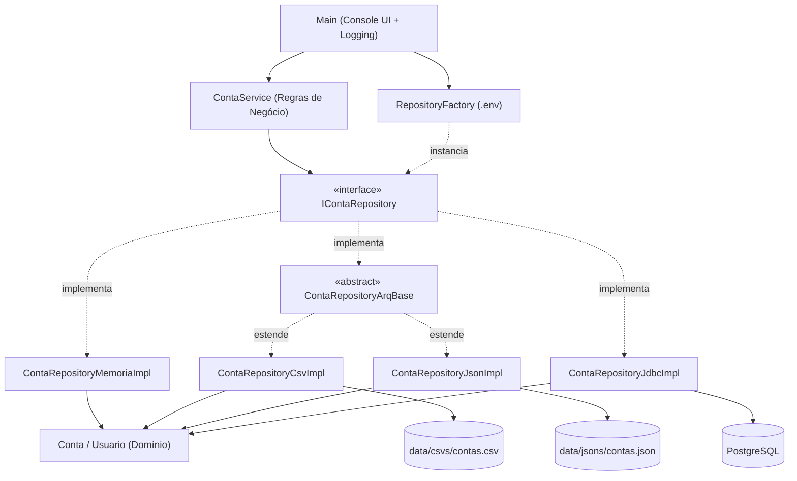

# 🏦 NexusNewBank

> Aplicação bancária de console em Java puro, criada com foco no estudo de **arquitetura de projeto**, **boas práticas**, **testes automatizados** e **evolução incremental** do código.

   

---

## 📋 Índice

- [Sobre o Projeto](#-sobre-o-projeto)
- [Funcionalidades](#-funcionalidades)
- [Arquitetura](#-arquitetura)
  - [Estrutura de Pacotes](#estrutura-de-pacotes)
  - [Diagrama de Dependências](#diagrama-de-dependências)
  - [Camadas da Aplicação](#camadas-da-aplicação)
  - [Estratégias de Persistência](#estratégias-de-persistência)
- [Testes Automatizados](#-testes-automatizados)
- [Boas Práticas Aplicadas](#-boas-práticas-aplicadas)
- [Decisões Técnicas](#-decisões-técnicas)
- [Tecnologias](#-tecnologias)
- [Como Executar](#-como-executar)
- [Versões e Branches](#-versões-e-branches)
- [Roadmap — Evolução do Projeto](#-roadmap--evolução-do-projeto)
- [Changelog](#-changelog)

---

## 💡 Sobre o Projeto

O **NexusNewBank** é um sistema bancário simplificado que roda no terminal. O objetivo principal **não** é ser um produto, mas sim servir como **laboratório de estudo** para:

- Praticar arquitetura em camadas (Layered Architecture)
- Aplicar princípios SOLID e padrões de projeto (Template Method, Simple Factory)
- Retomar fluência em Java após um período sem uso da linguagem
- Explorar diferentes formas de persistência (memória, arquivos e banco de dados relacional)
- Escrever testes unitários (JUnit 5 + Mockito) e de integração (Testcontainers + PostgreSQL)
- Aplicar logging estruturado (SLF4J + Logback)
- Documentar a evolução arquitetural do projeto ao longo do tempo

---

## ✨ Funcionalidades

| Operação         | Descrição                                         |
|------------------|---------------------------------------------------|
| Visualizar Conta | Consulta dados de uma conta pelo CPF              |
| Abrir Conta      | Cria uma nova conta com nome, CPF e saldo inicial |
| Deletar Conta    | Remove uma conta existente pelo CPF               |
| Depósito         | Adiciona saldo a uma conta                        |
| Saque            | Retira saldo de uma conta (com validação)         |
| Transferência    | Transfere valor entre duas contas                 |

Todas as operações são **persistidas** — os dados sobrevivem ao encerramento da aplicação (exceto no modo em memória).

---

## 🏗 Arquitetura

### Estrutura de Pacotes

```
NexusNewBank/
├── data/                                           # Arquivos de dados (persistência em arquivo)
│   ├── csvs/contas.csv
│   └── jsons/contas.json
├── .env                                            # Configuração de persistência e credenciais (NÃO versionado)
├── pom.xml
└── src/
    ├── main/java/com/linekerx/
    │   ├── Main.java                               # Ponto de entrada — UI de console + logging + inicialização
    │   ├── domain/                                 # Entidades de domínio (modelo de negócio)
    │   │   ├── Conta.java                          # Entidade Conta com operações de saldo
    │   │   └── Usuario.java                        # Record imutável representando o titular
    │   ├── exception/                              # Exceções customizadas
    │   │   ├── ContaInexistenteException.java
    │   │   ├── ContaJaExisteException.java
    │   │   ├── CpfInvalido.java
    │   │   ├── SaldoInicialNegativoException.java
    │   │   ├── SaldoInsuficienteException.java
    │   │   ├── ValorNegativoException.java
    │   │   ├── ErroAoCriarArq.java                 # Falha ao criar arquivo/diretório de dados
    │   │   ├── ErroLeituraArq.java                 # Falha ao ler arquivo de dados
    │   │   └── ErroSalvarDados.java                # Falha ao gravar/acessar arquivo ou banco de dados
    │   ├── repository/                             # Camada de persistência
    │   │   ├── IContaRepository.java               # Contrato (abstração) do repositório
    │   │   ├── RepositoryFactory.java              # Fábrica que instancia o repositório via .env
    │   │   ├── ContaRepositoryMemoriaImpl.java     # Implementação em memória (HashMap)
    │   │   ├── ContaRepositoryArqBase.java         # Classe abstrata base para persistência em arquivo
    │   │   ├── ContaRepositoryCsvImpl.java         # Implementação em CSV
    │   │   ├── ContaRepositoryJsonImpl.java        # Implementação em JSON (Gson)
    │   │   └── ContaRepositoryJdbcImpl.java        # Implementação em PostgreSQL (JDBC)
    │   ├── service/                                # Regras de negócio e orquestração
    │   │   └── ContaService.java
    │   └── utils/                                  # Utilitários de formatação
    │       ├── FormatCpf.java
    │       ├── FormatInput.java
    │       └── FormatSaldo.java
    └── test/
        ├── java/com/linekerx/
        │   ├── repository/
        │   │   └── ContaRepositoryJdbcImplTest.java # Testes de integração com Testcontainers (PostgreSQL)
        │   └── service/
        │       └── ContaServiceTest.java            # Testes unitários com JUnit 5 e Mockito
        └── resources/
            └── docker-java.properties               # Configuração de API do Docker para Testcontainers
```

### Diagrama de Dependências



> `exception/` e `utils/` são pacotes **transversais**, utilizados por várias camadas.

### Camadas da Aplicação

| Camada           | Pacote        | Responsabilidade                                                                         |
|------------------|---------------|------------------------------------------------------------------------------------------|
| **Apresentação** | `Main`        | Interação com o usuário via console, logging de eventos/erros e composição inicial.      |
| **Serviço**      | `service`     | Validações de negócio e orquestração. Depende **apenas** de `IContaRepository`.          |
| **Repositório**  | `repository`  | Contrato, fábrica (`RepositoryFactory`) e implementações (memória, CSV, JSON, JDBC).     |
| **Domínio**      | `domain`      | Entidades puras com comportamento próprio (ex: `Conta.depositar()`, `Conta.sacar()`).    |
| **Exceções**     | `exception`   | Exceções semânticas de negócio e de infraestrutura (I/O de arquivos e banco de dados).   |
| **Utilitários**  | `utils`       | Funções auxiliares de formatação (CPF, saldo, entrada do console).                       |

### Estratégias de Persistência

Todas as implementações seguem o mesmo contrato:

```java
public interface IContaRepository {
    void salvarConta(Conta conta);
    void removerConta(String cpf);
    Conta buscarPorCpf(String cpf);
    boolean existeContaParaCpf(String cpf);
}
```

| Valor no `.env` (`TIPO_PERSISTENCIA`) | Implementação                | Armazenamento            | Características                                                                              |
|---------------------------------------|------------------------------|--------------------------|----------------------------------------------------------------------------------------------|
| `memoria`                             | `ContaRepositoryMemoriaImpl` | `HashMap`                | Volátil — dados perdidos ao encerrar. Útil para testes rápidos/estudo.                       |
| `csv`                                 | `ContaRepositoryCsvImpl`     | `data/csvs/contas.csv`   | Cabeçalho `CPF;Nome;Saldo`. Aceita `;` ou `,` como separador na leitura.                     |
| `json`                                | `ContaRepositoryJsonImpl`    | `data/jsons/contas.json` | Serialização com **Gson** (pretty printing), mapa indexado por CPF.                          |
| `jdbc`                                | `ContaRepositoryJdbcImpl`    | PostgreSQL               | JDBC puro com `PreparedStatement`, *upsert* via `ON CONFLICT`, credenciais lidas do `.env`.  |

As implementações em arquivo compartilham a lógica comum na classe abstrata `ContaRepositoryArqBase` (padrão **Template Method**): ela mantém um cache em memória (`Map<String, Conta>`) e delega às subclasses apenas o que muda — `criarDirArq()`, `carregarContas()` e `salvarDados()`. Arquivos e diretórios são criados automaticamente caso não existam.

A seleção da estratégia de persistência é feita **sem alterar código**, através da `RepositoryFactory` lendo a variável `TIPO_PERSISTENCIA` no arquivo `.env`:

```java
public static IContaRepository criarContaRepository() {
    return switch (TIPO) {
        case "json" -> new ContaRepositoryJsonImpl();
        case "jdbc" -> new ContaRepositoryJdbcImpl();
        case "csv" -> new ContaRepositoryCsvImpl();
        case "memoria" -> new ContaRepositoryMemoriaImpl();
        default -> throw new IllegalArgumentException("Tipo de persistência não suportado: " + TIPO);
    };
}
```

---

## 🧪 Testes Automatizados

O projeto conta com duas frentes de testes automatizados organizadas com `@Nested` e `@DisplayName`:

1. **Testes Unitários (`ContaServiceTest`)**:
   - Utilizam **JUnit 5** e **Mockito** (`@ExtendWith(MockitoExtension.class)`, `@Mock`, `@InjectMocks`, `ArgumentCaptor`).
   - Testam isoladamente todas as regras de negócio de `ContaService` (abertura de conta, deleção, depósito, saque, transferência e busca por CPF), garantindo que o repositório não seja acionado quando validações falham (`verifyNoInteractions` / `verify(..., never())`).
2. **Testes de Integração (`ContaRepositoryJdbcImplTest`)**:
   - Utilizam **Testcontainers** (`PostgreSQLContainer` com a imagem `postgres:15-alpine`).
   - Sobem uma instância real do PostgreSQL em container Docker, criam/limpam a tabela `contas` antes de cada teste (`@BeforeEach`) e validam as queries SQL reais de inserção, atualização (*upsert* via `ON CONFLICT`), remoção, busca e verificação de existência.

---

## ✅ Boas Práticas Aplicadas

### 1. Separação de Responsabilidades (SRP)
Cada classe tem **uma única razão para mudar**:
- `Conta` → gerencia saldo
- `ContaService` → valida regras de negócio
- `IContaRepository` e implementações → armazenam/recuperam dados
- `RepositoryFactory` → centraliza a criação do repositório a partir da configuração
- `Main` → interface com o usuário, logging e fluxo de execução

### 2. Inversão de Dependência (DIP)
`ContaService` depende exclusivamente do **contrato** `IContaRepository`. Além disso, `ContaRepositoryJdbcImpl` oferece construtor com injeção explícita de credenciais (`url`, `user`, `password`), permitindo que os testes de integração injetem o container do Testcontainers sem depender do `.env`.

### 3. Aberto/Fechado (OCP), Substituição de Liskov (LSP) e Simple Factory
Novas formas de persistência são adicionadas criando novas classes que implementam `IContaRepository`. A `RepositoryFactory` encapsula a decisão de qual implementação instanciar com base na variável `TIPO_PERSISTENCIA` do `.env`.

### 4. Template Method para Reuso
`ContaRepositoryArqBase` centraliza o fluxo comum de persistência em arquivo, evitando duplicação entre CSV e JSON.

### 5. Exceções Semânticas e Específicas
Em vez de lançar `RuntimeException` genérica ou usar códigos de erro, o projeto define **exceções nomeadas**:

**Negócio**
- `ContaInexistenteException` — conta não encontrada
- `ContaJaExisteException` — CPF já cadastrado
- `CpfInvalido` — CPF fora do formato esperado
- `SaldoInsuficienteException` — saque superior ao saldo
- `SaldoInicialNegativoException` — abertura de conta com saldo negativo
- `ValorNegativoException` — depósito/saque/transferência com valor ≤ 0

**Infraestrutura (arquivos e banco de dados)**
- `ErroAoCriarArq` — falha ao criar arquivo/diretório de dados
- `ErroLeituraArq` — falha ao ler o arquivo de dados
- `ErroSalvarDados` — falha ao gravar/acessar arquivo de dados ou banco de dados via JDBC

As exceções de infraestrutura preservam a **causa original** (`IOException` / `SQLException`), facilitando o diagnóstico nos logs.

### 6. Observabilidade com Logging Estruturado — *novo na v3.0*
Uso de **SLF4J + Logback** na camada principal para registrar o ciclo de vida da aplicação (`info`/`debug`), violações de regras de negócio (`warn`) e falhas de infraestrutura com stacktrace (`error`), separando a mensagem amigável exibida ao usuário no console do registro técnico de auditoria.

### 7. Segurança no Acesso ao Banco
- Uso de `PreparedStatement` com parâmetros, prevenindo **SQL Injection**
- `try-with-resources` garantindo o fechamento de `Connection`, `PreparedStatement` e `ResultSet`
- Credenciais fora do código-fonte, em um arquivo `.env` **ignorado pelo Git**

### 8. Imutabilidade com Records
`Usuario` é declarado como `record`, tornando-o **imutável** por padrão — ideal para value objects.

```java
public record Usuario(String nome, String cpf) { }
```

### 9. Uso de `BigDecimal` para Valores Monetários
O projeto **evita `double`/`float`** para representar dinheiro, usando `BigDecimal` (inclusive no JDBC, via `setBigDecimal`/`getBigDecimal`).

### 10. Encapsulamento de Comportamento no Domínio (Rich Domain)
As operações de `depositar()` e `sacar()` vivem **dentro** da classe `Conta`, não no serviço — evitando o antipattern *Anemic Domain*.

### 11. Validação Defensiva
Todas as operações validam entradas **antes** de executar:
- CPF com 11 dígitos
- Saldo inicial ≥ 0
- Valores de operação > 0
- Existência da conta antes de operar

---

## 🔧 Decisões Técnicas

| Decisão                           | Justificativa                                                                          |
|-----------------------------------|----------------------------------------------------------------------------------------|
| Java 21 (LTS)                     | Versão LTS moderna com suporte consolidado a records, pattern matching e switch expressions |
| Maven                             | Gerenciamento de build e dependências padrão do ecossistema Java                       |
| Interface `IContaRepository`      | Desacoplar o serviço da forma de armazenamento (DIP)                                   |
| `RepositoryFactory` + `.env`      | Alternar entre `jdbc`, `json`, `csv` e `memoria` por configuração sem recompilar código |
| CSV e JSON antes do banco         | Evolução incremental: entender persistência "na mão" antes de usar um SGBD             |
| Gson                              | Biblioteca leve e simples para (de)serialização JSON                                   |
| JDBC puro (sem JPA/Hibernate)     | Entender os fundamentos de acesso a banco antes de adotar um ORM                       |
| PostgreSQL                        | Banco relacional robusto e amplamente usado; suporte a *upsert* com `ON CONFLICT`      |
| SLF4J + Logback                   | Padrão de mercado em Java para logging desacoplado e configurável                      |
| JUnit 5 + Mockito                 | Testes unitários rápidos e isolados para validar regras de negócio da camada `service` |
| Testcontainers                    | Testes de integração fidedignos contra um PostgreSQL real em container Docker          |
| `RuntimeException` como base      | Exceções não-checadas para evitar poluição de assinaturas de métodos                   |
| Sem frameworks (Spring, etc.)     | Estudo de fundamentos de Java puro sem "magia" antes de migrar para um ecossistema web |

---

## 🛠 Tecnologias

- **Java 21**
- **Maven** (build e dependências)
- **PostgreSQL** + **JDBC** (`org.postgresql:postgresql:42.7.2`)
- **Gson** (`com.google.code.gson:gson:2.10.1`)
- **dotenv-java** (`io.github.cdimascio:dotenv-java:3.0.0`)
- **Logback / SLF4J** (`ch.qos.logback:logback-classic:1.5.3`)
- **JUnit 5** (`org.junit.jupiter:junit-jupiter-engine:5.10.2`)
- **Mockito** (`org.mockito:mockito-core:5.14.2`, `org.mockito:mockito-junit-jupiter:5.14.2`)
- **Testcontainers** (`org.testcontainers:junit-jupiter:1.19.7`, `org.testcontainers:postgresql:1.19.7`)
- **Nenhum framework web/DI** — Java puro

---

## 🚀 Como Executar

### Pré-requisitos
- [JDK 21+](https://adoptium.net/)
- [Maven 3.9+](https://maven.apache.org/download.cgi)
- [PostgreSQL](https://www.postgresql.org/download/) — apenas se usar `TIPO_PERSISTENCIA=jdbc`
- [Docker](https://www.docker.com/) — apenas para executar os testes de integração (`ContaRepositoryJdbcImplTest`)

### 1. Preparar o banco de dados (modo JDBC)

Crie um banco e a tabela `contas`:

```sql
CREATE TABLE contas (
    cpf   VARCHAR(11)    PRIMARY KEY,
    nome  VARCHAR(100)   NOT NULL,
    saldo NUMERIC(15, 2) NOT NULL
);
```

### 2. Configurar o `.env`

Crie um arquivo `.env` na **raiz do projeto**:

```env
TIPO_PERSISTENCIA=jdbc
DB_URL=jdbc:postgresql://localhost:5432/nexusnewbank
DB_USER=seu_usuario
DB_PASSWORD=sua_senha
```

> [!IMPORTANT]
> O `.env` está no `.gitignore` e **nunca** deve ser commitado.

> [!TIP]
> Para rodar sem banco de dados, basta alterar `TIPO_PERSISTENCIA` no `.env` para `json`, `csv` ou `memoria`.

### 3. Compilar e executar

```bash
# Compilar o projeto (baixa as dependências)
mvn compile

# Executar a aplicação
mvn exec:java -Dexec.mainClass="com.linekerx.Main"
```

> Execute os comandos a partir da raiz do projeto, pois os caminhos `data/...` e o `.env` são relativos ao diretório de execução.

### 4. Executar os testes

```bash
# Executar todos os testes (requer Docker ativo para o Testcontainers)
mvn test

# Executar apenas os testes unitários do serviço (não requer Docker)
mvn test -Dtest=ContaServiceTest
```

---

## 🌿 Versões e Branches

Cada versão estável é congelada em uma branch própria e marcada com uma tag. A `main` segue com o desenvolvimento contínuo.

| Versão   | Branch     | Tag    | Resumo                                                                                 |
|----------|------------|--------|----------------------------------------------------------------------------------------|
| **v1.0** | `version1` | `v1.0` | Estrutura base em camadas com repositório em memória                                   |
| **v2.0** | `version2` | `v2.0` | Abstração do repositório + persistência em CSV, JSON e PostgreSQL                      |
| **v3.0** | `version3` | `v3.0` | `RepositoryFactory` via `.env`, Logging (Logback) e Testes (JUnit 5, Mockito, Testcontainers) |
| *next*   | `main`     | —      | Evolução concluída no escopo de Java puro                                              |

---

## 🗺 Roadmap — Evolução do Projeto

O projeto foi evoluído de forma incremental, concluindo todo o ciclo planejado para **Java puro**:

- [x] **v1.0** — Estrutura base com camadas (`domain`, `service`, `repository`, `exception`, `utils`)
- [x] **v2.0** — Interface para `Repository` (programar para abstrações) + persistência em arquivo (CSV/JSON) e banco de dados (PostgreSQL via JDBC)
- [x] **v3.0** — Seleção dinâmica de repositório por configuração (`RepositoryFactory` + `.env`), logging com SLF4J/Logback, testes unitários (JUnit 5 + Mockito) e testes de integração (Testcontainers + PostgreSQL)

---

## 📓 Changelog

### v3.0 — Testes, Logging e Configuração Dinâmica (Outubro 2026)
- ✅ `RepositoryFactory` para instanciar dinamicamente o repositório via `TIPO_PERSISTENCIA` no `.env` (`jdbc`, `json`, `csv`, `memoria`)
- ✅ Logging estruturado com **SLF4J + Logback** na `Main` (`info`, `debug`, `warn`, `error`)
- ✅ Padronização do tratamento de falhas de banco de dados no `ContaRepositoryJdbcImpl` com `ErroSalvarDados`
- ✅ Sobrecarga de construtor em `ContaRepositoryJdbcImpl` para injeção direta de credenciais em testes
- ✅ Testes unitários completos para `ContaService` (`ContaServiceTest`) com **JUnit 5** e **Mockito**
- ✅ Testes de integração para `ContaRepositoryJdbcImpl` (`ContaRepositoryJdbcImplTest`) com **Testcontainers** e **PostgreSQL**

### v2.0 — Persistência (Outubro 2026)
- ✅ Projeto renomeado para **NexusNewBank**
- ✅ Interface `IContaRepository` — `ContaService` passa a depender de abstração (DIP)
- ✅ `ContaRepository` renomeado para `ContaRepositoryMemoriaImpl`
- ✅ Classe abstrata `ContaRepositoryArqBase` com lógica comum para persistência em arquivo
- ✅ Persistência em **CSV** (`ContaRepositoryCsvImpl`)
- ✅ Persistência em **JSON** com Gson (`ContaRepositoryJsonImpl`)
- ✅ Persistência em **PostgreSQL** via JDBC (`ContaRepositoryJdbcImpl`) com *upsert* (`ON CONFLICT`)
- ✅ Configuração de credenciais via `.env` (`dotenv-java`) e `.env` adicionado ao `.gitignore`
- ✅ Novas exceções de infraestrutura: `ErroAoCriarArq`, `ErroLeituraArq`, `ErroSalvarDados`
- ✅ Criação automática de diretórios/arquivos de dados
- ✅ Tratamento de falhas de inicialização na `Main`

### v1.0 — Fundação (Agosto 2026)
- ✅ Estrutura de pacotes em camadas
- ✅ Entidades de domínio (`Conta`, `Usuario` como record)
- ✅ Exceções de negócio customizadas (6 tipos)
- ✅ Repository in-memory com `HashMap`
- ✅ Service com regras de negócio e validações
- ✅ Interface de console com menu interativo
- ✅ Utilitários de formatação (CPF, saldo, input)
- ✅ `BigDecimal` para valores monetários
- ✅ Injeção de dependência manual via construtor

---

## 📄 Licença

Este projeto é de uso pessoal e educacional.

---

<p align="center">
  Feito por <strong>Gabriel Lineker</strong>
</p>
